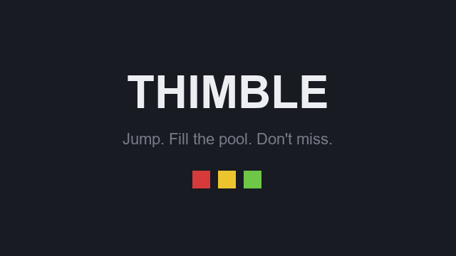

# Thimble

A Minecraft server plugin to build and play the "thimble" mini-game (*dé à coudre* in French).

Players take turns jumping from a diving board into a pool. Landing in the water places a block of
their color where they hit — the pool shrinks with every jump. Missing costs a life. The last
player alive wins.



In-game texts are in French; every one of them can be changed in `messages.yml`.

## Building

Requires **JDK 25** (mandatory since Minecraft 26.1).

```powershell
$env:JAVA_HOME = "<path to a JDK 25>"
.\gradlew.bat build      # -> build/libs/Thimble-0.2.0.jar
```

Built against `io.papermc.paper:paper-api:26.2.build.112-stable` (Gradle 9.7.1, no warnings).
`.\gradlew.bat test` runs the tests. Drop the jar into the `plugins/` folder of a **Paper 26.2**
server.

## Creating an arena

### 1. Build the play area

| Element | Recommended |
|---|---|
| Pool | 7×7 blocks, **3 blocks deep**, filled with source water up to the rim |
| Rim | solid blocks all around, nothing sticking out above the surface |
| Diving board | 1×1 to 3×3 platform, **20 to 30 blocks** above the water, centered on the pool |
| Waiting lobby | next to it, outside the pool |
| Spectator point | with a **view of the pool** (the bonus block is aimed from there) |

Only the surface layer counts: that is where blocks are placed. The layers below stay water to
break the fall.

### 2. Declare the arena — the wand

```
/th admin wand pool1
```

You get a **wand** (blaze rod) and four right-clicks are enough, in this order:

| Click | What to aim at |
|---|---|
| 1/4 | **the water**, at one corner of the pool |
| 2/4 | **the water**, at the opposite corner |
| 3/4 | the **diving board** block (players are teleported there on their turn) |
| 4/4 | the **stands** block (waiting before the game and return point after each jump) |

No need to move: the targeted block is found by a server-side ray trace, water included — the
client itself never lets you click on water. The arena is created if it does not exist, then
**enabled automatically** on the last click if everything is consistent; otherwise the plugin says
what is missing.

### 3. Fine-tuning (optional)

Every point placed by the wand can still be changed by command, and game settings — players,
lives, timer, palette — are set in the same place: see [Commands](#commands). The **playing
surface** is the highest Y of the two corners.

### 4. Check

`/th admin info pool1` shows the state, the settings, the number of water blocks detected and what
is still missing. A correctly placed 7×7 shows `eau=49` (water=49). If `eau=0`, the surface is in
the wrong place.

### Common pitfalls

- **`eau=0`**: the surface misses the water — set `pos1` again while standing *in* the edge water.
- **Flowing water** instead of source water: flowing water blocks do not count.
- **A block above the pool** (overhang, ceiling): players land on it, which counts as a miss.
- **Spectator point without a view** of the pool: the thimble bonus becomes impossible to aim.
- At least **2 players** are needed to start a game: the whole point is being the last one
  standing, `min` cannot go below 2.

## Playing

```
/th join [arena]       # no argument: the fullest free arena
/th solo [arena]       # practice game, alone
/th spectate <arena>   # watch a running game
/th leave
/th list
```

A **sign** can act as a join button: `[Thimble]` on the first line, the arena name on the second
(left empty = the fullest free arena). Right-clicking it joins without typing a command. It is a
toggle: clicking again while in a game leaves it, like `/th leave`.

**Solo mode**: starts right away, with no countdown and no opponent, on a free and empty arena. The
goal is to fill the whole pool without running out of lives. The game stops when lives run out —
the summary gives the number of blocks filled and thimbles landed — or ends in a win when the last
water block is filled. Unlike multiplayer, the pool is never refilled during the game: that is
precisely what makes the score.

A game starts on its own once `min` players are in (15 s countdown, 5 s if the arena is full).
Joining a game already running puts the player in spectator mode.

After a successful jump, the player stays 2 seconds in the water before going back to the stands; a
missed jump sends them back immediately.

After a **thimble** (landing in a 1×1 hole), the player is put in flight above the pool, looking
down and frozen — only the view moves. They have 8 seconds to right-click either a **water block**
(it gets filled) or a **block already placed** (it gets reopened). Only blocks placed during the
game can be reopened, never the floor or the edges of the pool.

When a game ends, players **stay in the arena**: a new countdown starts on its own, without typing
`/th join` again. `/th leave` to get out. A solo game releases the player at the end.

Disconnecting mid-game keeps the seat for 60 seconds; the inventory is returned immediately. If the
server goes down during a game, the original inventory and position are returned on the next login
— they are written to disk as soon as the player enters the arena.

During the game: the scoreboard lists players with their color and their lives as hearts, the action
bar shows the current instruction, the boss bar turns red under five seconds, and the end of the
game shows the full ranking. Each player's color also tints their dot on the locator bar (the
"radar"), their name tag and the particle trail of their fall. A player **waiting for their turn** is
held at the edge of the pool, so they cannot fall in and disrupt detection.

Titles, sounds, action bar, boss bar, scoreboard, particles, leaderboard panel (`leaderboard`) and
radar color (`radar`) can each be turned off in the `ui` section of `config.yml`.

## Leaderboard

A **floating panel** shows the server's persistent leaderboard — wins and thimbles, configurable TOP
size (`leaderboard.size`) — and the result of the last game. Stand where you want it, face the right
direction, then `/th admin setboard`; `/th admin clearboard` removes it, and setting it elsewhere
moves the old one.

It updates at the end of every **multiplayer game that ends normally**. Solo games (they are
practice), games stopped with `forcestop` and games won because every opponent left do not count.
Stats live in `stats.yml` and survive restarts; `ui.leaderboard: false` hides the panel but keeps
counting.

## Commands

`/thimble`, with the aliases `/th`, `/deacoudre` and `/dac`. Every command tab-completes, and
`/th help` only shows the admin lines to players allowed to use them.

### Player — permission `thimble.play`

| Command | Role |
|---|---|
| `/th join [arena]` | Joins a game. Without an argument, picks the **fullest** free arena, to group players rather than scatter them. If the game is already running, joins as a spectator. |
| `/th solo [arena]` | Practice game, alone. Starts immediately, without countdown. Needs a **free and empty** arena, so it fails if someone is already waiting. |
| `/th spectate <arena>` | Watches a game. The arena is required. Needs `thimble.spectate`. |
| `/th leave` | Leaves the game or spectating, and returns the original inventory, game mode and position. |
| `/th list` | Lists arenas with their state and player count. |
| `/th help` | Help, adapted to permissions. |

### Administration — permission `thimble.admin`

**Create an arena**

| Command | Role |
|---|---|
| `/th admin wand <arena>` | Gives the wand and guides the four clicks. **This is the normal way**: creates the arena if needed and enables it at the end. |
| `/th admin create\|delete <arena>` | Creates an empty arena, or deletes it. The name only accepts letters, digits, dash and underscore. |

**Place the points** — each command records *your current position*, facing included.

| Command | Role |
|---|---|
| `/th admin setjump <arena>` | The diving board. Players are teleported there on their turn, facing the way you were. |
| `/th admin setwait <arena>` | The waiting lobby, before the game starts. |
| `/th admin setspectator <arena>` | The return point after each jump. The wand sets it to the same spot as the lobby; these two commands let you separate them. |
| `/th admin pos1\|pos2 <arena>` | The two opposite corners of the pool. **Stand in the water**: the block under your feet is the one recorded. |
| `/th admin setsurface <arena> [y]` | Forces the playing surface. Without an argument, uses your current height. Useful if the two corners are not at the same level. |

**Settings**

| Command | Role |
|---|---|
| `/th admin set <arena> min <n>` | Players needed to start the countdown. Minimum: 2. |
| `/th admin set <arena> max <n>` | Available seats. Beyond the palette size, two players would share a color. |
| `/th admin set <arena> lives <n>` | Lives per player. Minimum: 1. |
| `/th admin set <arena> timeout <s>` | Seconds allowed to complete a jump, fall included. Minimum: 3. |
| `/th admin palette <arena> <add\|remove\|clear\|list> [block]` | Colors given to players, in order. When empty, the arena uses `default-palette` from `config.yml`. Any dyed block works: wool, concrete, terracotta, glass. |

**Operations**

| Command | Role |
|---|---|
| `/th admin enable <arena>` | Makes the arena playable. Refuses as long as something is missing, and says what. |
| `/th admin disable <arena>` | Stops the running game and takes the arena out of play. |
| `/th admin info <arena>` | State, settings, water blocks detected, palette, and what is missing. **The first thing to check when an arena does not behave as expected.** |
| `/th admin restore <arena>` | Refills the pool with water. Works even after a restart, when the plugin has lost track of placed blocks. |
| `/th admin forcestart <arena>` | Starts without waiting: skips the running countdown, or starts the game before `min` players are in. Refuses if the arena is empty or already playing. |
| `/th admin forcestop <arena>` | Stops the game and sends everyone back to where they started. |
| `/th admin reload` | Reloads `config.yml`, `messages.yml` and `arenas.yml`. **Stops running games**: avoid it while the server is busy. |

**Leaderboard** — these two commands take no arena: there is one panel per server.

| Command | Role |
|---|---|
| `/th admin setboard` | Places the floating leaderboard panel at your position, facing included. Moves it if it existed elsewhere. |
| `/th admin clearboard` | Removes the panel. |

### Permissions

| Permission | Default | Grants |
|---|---|---|
| `thimble.play` | everyone | `join`, `solo`, `leave`, `list`, `help` |
| `thimble.spectate` | everyone | `spectate` |
| `thimble.admin` | operators | `/th admin …` |

## Updating

Replace the jar in `plugins/` then **restart** the server. Neither `config.yml`, `messages.yml` nor
`arenas.yml` is overwritten, and there is nothing to delete: settings and texts missing from an
existing file fall back to those in the jar. To see the new commented options, delete the file
concerned and it will be regenerated in full.

One exception since this version: the waiting screen now shows `players/max` instead of
`players/min`. If you have a customized `messages.yml`, replace `<min>` with `<max>` in
`scoreboard.waiting` and `actionbar.waiting` — otherwise these lines would show a literal `<min>`.

## Documentation

- [Game and plugin specification](docs/SPECIFICATIONS.md) — rules, technical target, architecture,
  jump detection, commands, files, display, and what is deliberately not done.

## License

[MIT](LICENSE)
